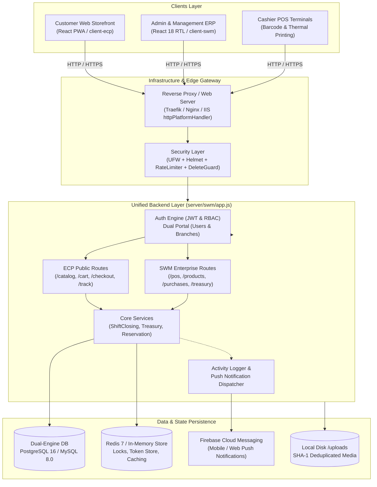
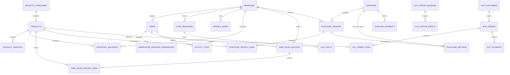

# 📘 Yoka Store Enterprise Platform — Complete System & Architecture Documentation

> **Version:** 1.0.0 (Bulk 1 & Phase 2 Verified)  
> **Authors & Architectural Leads:** Moustafa Maher & Engineering Team  
> **Repository:** `YokaStorePlatformVPS`  
> **Production Target:** Multi-Branch Retail Chains, Central Warehouses & High-Traffic E-Commerce Operations  
> **Deployment Ecosystems:** Ubuntu 24.04 LTS (Docker / Coolify / PM2) & Windows Server (IIS / Monster ASP / Web Deploy)

---

## Table of Contents
1. [Project Overview](#1-project-overview)
   - [Purpose and Mission](#purpose-and-mission)
   - [Target Users and Roles](#target-users-and-roles)
   - [High-Level Architectural Model](#high-level-architectural-model)
   - [Comprehensive Tech Stack Matrix](#comprehensive-tech-stack-matrix)
2. [Architecture & Directory Structure](#2-architecture--directory-structure)
   - [Monorepo Anatomy & Responsibilities](#monorepo-anatomy--responsibilities)
   - [End-to-End Data Flow & Lifecycle](#end-to-end-data-flow--lifecycle)
   - [Key Software Design Patterns](#key-software-design-patterns)
   - [System Architecture Diagram](#system-architecture-diagram)
3. [Setup & Installation Guide](#3-setup--installation-guide)
   - [Prerequisites](#prerequisites)
   - [Step-by-Step Local Environment Setup](#step-by-step-local-environment-setup)
   - [Master Environment Variables Reference](#master-environment-variables-reference)
   - [Running Verification & Integration Tests](#running-verification--integration-tests)
4. [Core Modules & Components Deep-Dive](#4-core-modules--components-deep-dive)
   - [Shared Infrastructure & Resilience Layer](#shared-infrastructure--resilience-layer)
   - [Security & Access Control Engine](#security--access-control-engine)
   - [Procurement, Inventory & Treasury Core Services](#procurement-inventory--treasury-core-services)
   - [Frontend Architecture: SWM Admin & ECP Storefront](#frontend-architecture-swm-admin--ecp-storefront)
5. [Complete API Reference](#5-complete-api-reference)
   - [Authentication & Session (`/api/auth`)](#authentication--session-apiauth)
   - [Retail POS & Cashier Management (`/api/swm/pos`)](#retail-pos--cashier-management-apiswmpos)
   - [Catalog & Inventory Management (`/api/swm/products`, `/api/swm/categories`, `/api/swm/attributes`)](#catalog--inventory-management)
   - [Supply Chain & Procurement (`/api/swm/suppliers`, `/api/swm/purchases`)](#supply-chain--procurement)
   - [Branch Transfers & Inventory Auditing (`/api/swm/transfers`, `/api/swm/stock-audit`, `/api/swm/stock-adjustments`)](#branch-transfers--inventory-auditing)
   - [Treasury, Shifts & Financial Tracking (`/api/swm/treasury`, `/api/swm/branches-daily`, `/api/swm/branch-shifts-monitor`)](#treasury-shifts--financial-tracking)
   - [E-Commerce Public API (`/api/ecp/catalog`, `/api/ecp/cart`, `/api/ecp/checkout`, `/api/ecp/track`)](#e-commerce-public-api)
6. [Database Schema & Entity-Relationship Architecture](#6-database-schema--entity-relationship-architecture)
   - [Master Tables & Data Dictionaries](#master-tables--data-dictionaries)
   - [Database Indexes & Constraints](#database-indexes--constraints)
   - [Mermaid Entity-Relationship Diagram (ERD)](#mermaid-entity-relationship-diagram-erd)
7. [Configuration, Hardening & Deployment](#7-configuration-hardening--deployment)
   - [Production Strategy 1: Linux VPS (Docker + PM2 Cluster + Coolify)](#production-strategy-1-linux-vps-docker--pm2-cluster--coolify)
   - [Production Strategy 2: Windows Server / Monster ASP (IIS + Web Deploy)](#production-strategy-2-windows-server--monster-asp-iis--web-deploy)
   - [CI/CD Automated Deployment Pipelines](#cicd-automated-deployment-pipelines)
   - [Configuration Files Deep-Dive](#configuration-files-deep-dive)
8. [Known Issues, Technical Debt & Roadmap](#8-known-issues-technical-debt--roadmap)
9. [Domain Glossary & Terminology](#9-domain-glossary--terminology)

---

## 1. Project Overview

### Purpose and Mission
**Yoka Store Platform** is an enterprise-grade, multi-branch omni-channel retail management and e-commerce ecosystem designed for retail operations managing physical branches, central warehouses, and an online public storefront.

The platform solves core enterprise challenges in the retail sector:
1. **Unified Stock Synchronization:** Eliminates inventory drift across physical retail locations, central warehouses, and online shopping carts through atomic distributed reservations.
2. **Multi-Tender Financial Settlement:** Enforces strict multi-tender payment tracking (**Cash**, **Bank Transfer / InstaPay**, **E-Wallet**) across procurement, sales, daily shifts, and safe transfers, eliminating untracked financial leakage.
3. **Automated End-of-Day (EOD) Reconciliation:** Guarantees that daily cashier shifts are audited, closed, and transferred to branch safes or the central headquarters treasury both manually and via automated cron jobs.
4. **Owner-Supervised Governance:** Employs an Owner-Only deletion lock (`deleteGuard`), real-time Arabic push notifications via Firebase Cloud Messaging for critical warehouse manager operations, and fine-grained role-based access control.

### Target Users and Roles
The platform segregates duties into tailored user interfaces and access permissions:
- **System Owner (`super_admin`):** Complete system authority; sole role permitted to execute `DELETE` operations across all tables; receives instant push notifications on operational mutations; accesses system backups and configuration.
- **System Administrator (`admin`):** Oversees cross-branch operations, user administration, global pricing, and supplier ledgers.
- **Warehouse Manager (`warehouse_manager`):** Manages supplier purchase invoices, goods receipt notes, inter-branch stock dispatches, and warehouse audits, bound by granular toggleable permissions.
- **Branch Supervisor (`supervisor`):** Supervises a single branch or group of branches; reviews daily cashier sessions, expense vouchers, cash drawer limits, and branch inventory.
- **Cashier / Salesperson (`salesperson`):** Fast barcode-driven Point of Sale (POS), item scanning, customer loyalty registration, invoice generation, and cash drawer management.
- **Online Customer (Public Shopper):** Navigates the public storefront (`client-ecp`), filters catalog products, reserves items for 15 minutes in cart, and checks out using Cash on Delivery or electronic payment methods with receipt uploads.

### High-Level Architectural Model
The platform is organized as a high-performance **Full-Stack Monorepo**:
- **Unified Express Backend:** A single resilient Node.js server (`server/swm/app.js`) handles both the administrative ERP (`/api/swm/*`) and customer e-commerce (`/api/ecp/*`) APIs. It dynamically compiles and serves the built frontend single-page applications (`client-swm` at `/swm-admin/` and `client-ecp` at `/`).
- **Dual-Dialect Database Engine:** The custom database abstraction (`server/shared/db.js`) enables dynamic switching between **PostgreSQL** (development, testing, and modern cloud hosting) and **MySQL 8.0** (standard production VPS) with SQL parameter normalization (`$1` vs `?`) and automatic reconnection on idle socket drops.
- **Zero-Dependency Development Mode:** Redis, Firebase, and remote databases contain graceful in-memory fallbacks, allowing developers to clone, install, and run the entire suite locally without mandatory background daemons.

### Comprehensive Tech Stack Matrix

| Layer | Technology | Version | Purpose & Description |
| :--- | :--- | :--- | :--- |
| **Runtime** | **Node.js** | `>= 20.0.0` (Alpine/LTS) | Asynchronous non-blocking runtime powering backend services and bundling pipelines. |
| **Backend Framework** | **Express.js** | `^4.21.0` | HTTP application framework handling REST endpoints, middleware pipelines, and static assets. |
| **Database Query Builder** | **Knex.js** | `^3.1.0` | Dialect-agnostic schema migration runner and SQL builder. |
| **Relational Drivers** | **pg** / **mysql2** | `^8.12.0` / `^3.9.7` | Native connection pooling drivers for PostgreSQL and MySQL 8. |
| **Caching & In-Memory Store** | **ioredis** | `^5.3.2` | Distributed cache, mutex locks, and session refresh token storage. |
| **Schema Validation** | **Zod** | `^4.6.5` | Strict declarative input validation for procurement, payments, and invoices. |
| **Security & Headers** | **Helmet** | `^8.0.0` | HTTP security headers (CSP, frame protection, script restrictions). |
| **Rate Limiting** | **express-rate-limit** | `^8.7.0` | Brute force defense and IP throttling across public and auth endpoints. |
| **Authentication & Crypto** | **jsonwebtoken** / **bcryptjs** | `^9.0.2` / `^2.4.3` | HMAC-SHA256 JWT access/refresh token generation and salted password hashing. |
| **Push Notifications** | **firebase-admin** | `^14.5.0` | Server-side Firebase Cloud Messaging (FCM) dispatch to mobile and web browsers. |
| **File Uploads** | **multer** | `^2.4.0` | Multipart form-data parser for invoice receipts, product images, and documents. |
| **Compression** | **compression** | `^1.8.2` | Gzip and Brotli HTTP response compression for low-latency bandwidth reduction. |
| **Admin Frontend UI** | **React** + **Vite** | `^18.3.1` / `^5.4.2` | Arabic RTL enterprise admin portal (`client-swm`) with Lucide Icons and Dayjs. |
| **Component Libraries** | **Ant Design (AntD)** | `^5.20.2` | Enterprise data tables, date pickers, modals, forms, and grid layouts. |
| **Visual Analytics** | **Recharts** | `^3.10.1` | SVG data charting for store sales, visitor funnels, and expenses. |
| **Barcodes** | **JsBarcode** | `^3.12.3` | Client-side EAN-13 barcode rendering for thermal printing and product tags. |
| **Storefront Frontend UI** | **React** + **Vite PWA** | `^18.3.1` / `^5.4.2` | Mobile-optimized e-commerce storefront (`client-ecp`) with offline PWA support. |
| **Process Management** | **PM2** | Global / `ecosystem` | Multi-instance clustering, automatic restarts, and log rotation. |

---

## 2. Architecture & Directory Structure

### Monorepo Anatomy & Responsibilities

```
YokaStorePlatformVPS/
├── .github/
│   └── workflows/
│       └── deploy.yml              # GitHub Actions automated webhook trigger for Coolify
├── client-ecp/                     # E-Commerce Customer Storefront (Public Store)
│   ├── public/                     # Favicons, web.config, manifest.webmanifest, service worker
│   ├── src/
│   │   ├── components/             # Storefront UI (Navbar, ProductCard, CartDrawer, TrustBar, SEO)
│   │   ├── hooks/                  # useDebounce and reactive hooks
│   │   ├── pages/                  # Home, Catalog, ProductDetail, Checkout, OrderSuccess, Contact, Branches
│   │   ├── services/               # tracker.js (non-blocking visitor telemetry client)
│   │   ├── api.js                  # Axios client configured for /api/ecp/* endpoints
│   │   ├── App.jsx                 # Storefront layout, cart state provider, and React Router routes
│   │   └── main.jsx                # React root mount and Ant Design theme provider
│   ├── package.json                # Storefront dependencies (React 18, AntD, vite-plugin-pwa)
│   └── vite.config.js              # Vite build setup with PWA service worker injection
├── client-swm/                     # Smart Warehouse & Store Management (Admin & POS ERP)
│   ├── public/                     # PWA manifest, service workers, static logos
│   ├── src/
│   │   ├── components/             # Reusable enterprise components:
│   │   │   ├── BarcodePrintModal.jsx    # Thermal and A4 barcode printing dialogs
│   │   │   ├── SplitPayment.jsx         # Multi-tender payment allocator (Cash, Bank, E-Wallet)
│   │   │   ├── ThermalReceipt.jsx       # 80mm ESC/POS formatted receipt renderer
│   │   │   ├── VariantMatrix.jsx        # Dynamic Color x Size product matrix generator
│   │   │   └── VisitorAnalytics.jsx     # Live visitor radar and telemetry charts
│   │   ├── pages/                  # Enterprise modules:
│   │   │   ├── admin/              # Super Admin navigation hub and analytics dashboards
│   │   │   ├── pos/                # Fast cashier terminal (SellerApp.jsx)
│   │   │   ├── warehouse/          # Warehouse Manager tailored workspace (WarehouseManagerApp.jsx)
│   │   │   ├── ecom/               # E-Commerce packing, shipping and dispatch hub
│   │   │   ├── Products.jsx        # Product catalog master with barcode scanners
│   │   │   ├── Purchases.jsx       # Supplier purchasing and inline price updating
│   │   │   ├── Transfers.jsx       # Branch-to-branch inventory transfer dispatch & receive
│   │   │   ├── TreasuryAdmin.jsx   # Multi-channel safe balances, payroll, and withdrawals
│   │   │   └── BranchesDaily.jsx   # Daily shift auditing, reconciliation, and fund sweep
│   │   ├── utils/                  # Barcode validators, permission checks, print engines
│   │   ├── api.js                  # Axios client with JWT refresh token interceptors
│   │   └── App.jsx                 # Role-based route guard and top-level navigation layout
├── migrations/                     # 21 Dialect-Agnostic Knex Schema Migration Files
│   ├── 001_initial_schema.js       # Core 35+ relational tables
│   ├── 002_add_payment_breakdown.js # Multi-tender columns for purchases and supplier accounts
│   ├── 003_purchase_returns.js     # Goods returns to suppliers with ledger balance adjust
│   ├── 004_ecp_payment_methods.js  # Dynamic payment methods (InstaPay, Wallets) & receipt uploads
│   ├── 010_visitor_tracking.js     # Visitor sessions and high-resolution event streaming
│   ├── 014_warehouse_manager_permissions.js # Granular permission matrix for warehouse staff
│   ├── 020_create_cash_transfers.js # Inter-branch and safe cash transfers
│   └── 021_create_ecp_shipping_rates.js # Governorates and flat shipping rate matrix
├── scripts/                        # Operational, automation, and test scripts
│   ├── deploy_monster.ps1          # Windows MSDeploy script targeting Monster ASP
│   ├── package_monster.ps1         # Esbuild standalone server packager and asset bundler
│   ├── provision-vps.sh            # Ubuntu 24.04 server provisioning and hardening automation
│   ├── test_acid_rollback.js       # Verification of transaction rollback on database failure
│   ├── test_eod_shift_closure.js   # Integration test for 1:00 AM shift closing and safe transfers
│   └── test_payment_methods.js     # Integration test for multi-tender split payment calculations
├── seeders/
│   └── seed.js                     # Master data seeder (Branches, Admins, Categories, Cash Registers)
├── server/                         # Unified Backend Services Layer
│   ├── ecp/                        # Public E-Commerce storefront routes
│   │   └── routes/                 # catalog.js, cart.js, checkout.js, tracking.js, sitemap.js
│   ├── shared/                     # Shared cross-cutting modules:
│   │   ├── db.js                   # Dual-dialect database connection pool and retry engine
│   │   ├── redis.js                # IORedis proxy with in-memory fallback
│   │   ├── inventoryReservation.js # Distributed mutex locks and 15-minute stock hold
│   │   ├── authMiddleware.js       # JWT validation, RBAC, branch isolation, and WM permissions
│   │   ├── deleteGuard.js          # Owner-only DELETE HTTP method protection middleware
│   │   ├── activityLogger.js       # Async non-blocking audit logging & FCM push trigger
│   │   ├── pushNotificationService.js # Firebase Cloud Messaging Admin SDK client
│   │   ├── imageStore.js           # Base64 image decoder and SHA-1 deduplicator
│   │   ├── barcode.js              # EAN-13 generator with Modulo-10 checksum
│   │   ├── geoLookup.js            # Egyptian IP governorate and city resolver
│   │   └── validators.js           # Declarative Zod schemas
│   └── swm/                        # Enterprise Retail Management & ERP System
│       ├── app.js                  # Master Express application entry point
│       ├── cron/                   # shiftClosingJob.js (Automated daily 1:00 AM shift sweep)
│       ├── services/               # shiftClosingService.js, treasuryService.js
│       └── routes/                 # 26 Enterprise modular REST routers
├── Dockerfile                      # 3-Stage Multi-Architecture Production Container Build
├── ecosystem.config.js             # PM2 Cluster Mode configuration
├── knexfile.js                     # Knex configuration for PostgreSQL & MySQL 8
└── package.json                    # Monorepo root scripts and production dependencies
```

---

### End-to-End Data Flow & Lifecycle

The following sequence illustrates how an authenticated transaction (e.g., placing an order, closing a shift, or registering a purchase) flows through the platform:

```
[ Client Request (Browser / POS / ECP) ]
                 │
                 ▼
 1. Reverse Proxy (Nginx / Coolify / Traefik / IIS httpPlatformHandler)
                 │  - SSL Offloading & Port Forwarding
                 ▼
 2. Express Server (`server/swm/app.js`)
                 │  - app.set('trust proxy', 1)
                 │  - compression() [Gzip / Brotli]
                 │  - helmet() [Hardened CSP & XSS Headers]
                 │  - cors() [Origin Verification]
                 ▼
 3. Rate Limiter Middleware (`express-rate-limit`)
                 │  - General API: 500 req / 15 min
                 │  - Auth API: 100 req / 15 min (Dev: 3000)
                 ▼
 4. Global Delete Guard (`server/shared/deleteGuard.js`)
                 │  - If Method === 'DELETE': Enforce req.user.role === 'super_admin'
                 ▼
 5. Route Authentication & Scoping (`server/shared/authMiddleware.js`)
                 │  - `requireAuth`: Verifies Bearer JWT Access Token
                 │  - `requireRole`: Enforces RBAC Role Matrix
                 │  - `requireBranchScope`: Locks staff to their branch data; grants admins global access
                 │  - `requireWarehousePermission`: Validates fine-grained WM permission flags
                 ▼
 6. Input Validation Layer (`server/shared/validators.js`)
                 │  - Declarative Zod schemas sanitize input; reject malformed requests with 400
                 ▼
 7. Service & Transaction Layer (`server/swm/services/*`)
                 │  - `transaction(async (client) => { ... })`
                 │  - Mutex Lock / Row-Level Lock (`SELECT ... FOR UPDATE`)
                 │  - Business logic: update inventory, calculate split tender, mutate cash drawer
                 ▼
 8. Database Adapter Layer (`server/shared/db.js`)
                 │  - `normalizeSql`: Dynamically maps query syntax ($1 vs ?)
                 │  - PostgreSQL Pool (Dev/Testing) or MySQL 8 Pool (Production)
                 │  - Stale socket retry: Automatically recovers from dead idle connections
                 ▼
 9. Background Side-Effects (Fire-and-Forget, Non-Blocking)
                 │  - `logActivity()`: Inserts structured log into `activity_logs`
                 │  - `notifyOwnerOfAction()`: Triggers FCM Push Notification to System Owner
                 │  - `redis.del()`: Invalidates storefront catalog caches
                 ▼
 10. Structured HTTP Response
                 └── Returns `{ success: true, data: ..., message: ... }`
```

---

### Key Software Design Patterns

1. **SQL Dialect Normalization (Adapter Pattern):**  
   Implemented in [`server/shared/db.js`](server/shared/db.js). Queries can be written using PostgreSQL `$1, $2` syntax or standard MySQL `?` syntax. The adapter inspects the active database client and normalizes parameter tokens on the fly, enabling cross-database portability without rewriting route SQL.

2. **Distributed Mutex Lock & Temporary Reservation:**  
   Implemented in [`server/shared/inventoryReservation.js`](server/shared/inventoryReservation.js). Prevents overselling during high-traffic checkout spikes. Stock is temporarily reserved in Redis for 15 minutes (`ecp:reserve:<branch>:<product>:<variant>:<token>`). If the customer abandons checkout, the TTL expires automatically without database intervention.

3. **Circuit-Breaker & In-Memory Fallbacks:**  
   Implemented in [`server/shared/redis.js`](server/shared/redis.js) and [`server/shared/pushNotificationService.js`](server/shared/pushNotificationService.js). If Redis or Firebase credentials are missing or the services go offline, the system seamlessly activates internal in-memory maps (`memoryStore`) and logs warning notices, preventing the application from crashing.

4. **Unit of Work & Atomic Row Locking:**  
   Implemented in [`server/swm/services/shiftClosingService.js`](server/swm/services/shiftClosingService.js) and POS invoice checkout. Critical transactions acquire database row-level locks (`SELECT ... FOR UPDATE`), ensuring that drawer balances and inventory balances are never subject to race conditions.

5. **Fire-and-Forget Asynchronous Event Logging:**  
   Implemented in [`server/shared/activityLogger.js`](server/shared/activityLogger.js). Audit logging operations are detached from the synchronous HTTP request flow, guaranteeing that an audit logging hiccup can never fail or delay a customer or cashier transaction.

6. **Static File Serving & Dynamic SSR Meta Tag Injection:**  
   Implemented in [`server/swm/app.js`](server/swm/app.js). The unified server serves compiled Vite bundles, while dynamically intercepting `/product/:slug` requests to fetch product metadata and inject Open Graph, Twitter Cards, and Schema.org JSON-LD structured data into the HTML response for social media rich previews (WhatsApp, Facebook, Googlebot).

---

### System Architecture Diagram



---

## 3. Setup & Installation Guide

### Prerequisites
Before setting up the project, ensure the following runtimes and services are available:
- **Node.js:** Version `20.x` LTS or higher.
- **npm:** Version `10.x` or higher.
- **Database:** PostgreSQL `15+` or MySQL `8.0+`.
- **Redis (Optional):** Redis `7.x` (if omitted, the system automatically uses an in-memory fallback).
- **Git:** Version `2.30+`.

---

### Step-by-Step Local Environment Setup

#### 1. Clone the Repository
```bash
git clone https://github.com/mustfamaheer-dotcom/YokaPlatform.git
cd YokaPlatform
```

#### 2. Install Dependencies
Run the global installation script from the project root to install dependencies across the server, admin portal, and storefront:
```bash
npm run install:all
```
*(This triggers `npm install` in the root, `client-swm/`, and `client-ecp/`)*.

#### 3. Configure Environment Variables
Copy the development environment template to `.env` in the root directory:
```bash
cp .env.example .env
```
Ensure database credentials match your local setup:
```env
NODE_ENV=development
DB_CLIENT=pg
DB_HOST=127.0.0.1
DB_PORT=5432
DB_NAME=yoka_store_dev
DB_USER=postgres
DB_PASS=your_password
DB_SSL=false

REDIS_HOST=127.0.0.1
REDIS_PORT=6379
ENABLE_REDIS=false

JWT_SECRET=super_secret_yoka_development_key_2026
PORT_SWM=3001
CLIENT_ORIGIN=http://localhost:5173
```

#### 4. Execute Relational Migrations
Initialize all 35+ tables and schema extensions:
```bash
npm run migrate
```
To roll back the last migration batch if needed:
```bash
npm run migrate:rollback
```

#### 5. Seed Core Master Data
Populate default branches, administrator accounts, categories, and cash registers:
```bash
npm run seed
```
**Default Seeded Credentials:**
- **System Owner / Super Admin:**
  - Username: `admin`
  - Password: `Yoka@Admin2026!`
- **Branch Supervisor (Maadi Branch):**
  - Username: `supervisor1`
  - Password: `Yoka@Branch2026!`
- **Branch Cashier (Maadi Branch):**
  - Username: `cashier1`
  - Password: `Yoka@Branch2026!`
- **Branch Portal Logins:**
  - Main Branch: `branch_main` / `Yoka@Branch2026!`
  - Retail Branch: `branch_retail` / `Yoka@Branch2026!`
  - E-Commerce Warehouse: `branch_ecom` / `Yoka@Branch2026!`

#### 6. Launch Development Servers
Run the unified multi-process environment:
```bash
# Terminal 1: Backend Server (runs on http://localhost:3001 with nodemon)
npm run dev:swm

# Terminal 2: Admin ERP Client (runs on http://localhost:5173)
npm run dev:client

# Terminal 3: E-Commerce Storefront (runs on http://localhost:3000)
npm run dev:ecp
```
Alternatively, on Windows, double-click `start-dev.bat` to launch all services automatically.

---

### Master Environment Variables Reference

| Variable Name | Required | Default Value | Description & Allowed Values |
| :--- | :---: | :--- | :--- |
| `NODE_ENV` | Yes | `development` | Operating environment (`development`, `production`, `test`). |
| `PORT` / `PORT_SWM` | No | `3001` | HTTP listening port for the unified Express server. |
| `DB_CLIENT` | Yes | `pg` | Database dialect: `pg` (PostgreSQL) or `mysql2` (MySQL 8). |
| `DB_HOST` | Yes | `127.0.0.1` | Database server hostname or Docker service name. |
| `DB_PORT` | Yes | `5432` / `3306` | Database listening port (`5432` for Postgres, `3306` for MySQL). |
| `DB_NAME` | Yes | `yoka_production` | Relational database name. |
| `DB_USER` | Yes | — | Database connection username. |
| `DB_PASS` | Yes | — | Database connection password. |
| `DB_SSL` | No | `false` | Enable SSL encryption for remote database connections (`true`/`false`). |
| `ENABLE_REDIS` | No | `false` | When `true`, connects to real Redis; when `false`, uses fast in-memory store. |
| `REDIS_HOST` | No | `127.0.0.1` | Redis server hostname. |
| `REDIS_PORT` | No | `6379` | Redis server port. |
| `REDIS_PASSWORD` | No | `""` | Optional authentication password for Redis. |
| `JWT_SECRET` | Yes | — | Cryptographic secret key used to sign and verify HMAC-SHA256 tokens. |
| `JWT_EXPIRES_IN` | No | `1h` | Time-to-live for access tokens (`1h`, `30m`). |
| `JWT_REFRESH_EXPIRES_IN` | No | `7d` | Time-to-live for refresh tokens (`7d`, `30d`). |
| `CLIENT_ORIGIN` | No | `http://localhost:5173` | Allowed CORS origin for the SWM Admin client. |
| `ECP_ORIGIN` | No | `http://localhost:3000` | Allowed CORS origin for the E-Commerce storefront. |
| `PUBLIC_STORE_URL` | No | `https://yokastore.runasp.net` | Canonical public store URL used for dynamic SEO meta tags and sitemap. |
| `UPLOADS_DIR` | No | `/app/uploads` | Absolute or relative path to persist uploaded product images and receipts. |
| `ONLINE_BRANCH_ID` | No | `1` | Warehouse branch ID designated to fulfill e-commerce storefront orders. |
| `FIREBASE_PROJECT_ID` | No | — | Google Firebase project identifier for Web Push. |
| `FIREBASE_CLIENT_EMAIL`| No | — | Service account client email address. |
| `FIREBASE_PRIVATE_KEY` | No | — | RSA Private key string (newlines formatted as `\n`). |

---

### Running Verification & Integration Tests

The project includes purpose-built automated test scripts located in `scripts/`:

```bash
# 1. Test ACID Transaction Rollback
# Verifies that intentional failures mid-transaction abort all balance changes without phantom funds
node scripts/test_acid_rollback.js

# 2. Test End-of-Day (EOD) 1:00 AM Shift Closure
# Verifies row locks, sales aggregation, safe transfer calculation, and journal entries
node scripts/test_eod_shift_closure.js

# 3. Test Multi-Tender Split Payment Math
# Verifies that Cash + Card + Transfer allocations strictly equal target amounts
node scripts/test_payment_methods.js

# 4. Test Warehouse Manager Granular Permissions
# Verifies that warehouse staff cannot access restricted financial or admin endpoints
node scripts/test_warehouse_manager.js

# 5. Test Bulk Product & Inventory Import
# Verifies batch ingestion and barcode validation
node scripts/test_bulk1.js
```

---

## 4. Core Modules & Components Deep-Dive

### Shared Infrastructure & Resilience Layer

#### 1. Database Connection & Dialect Adapter (`server/shared/db.js`)
- **Responsibility:** Manages connection pooling, handles connection terminations, and normalizes queries between PostgreSQL and MySQL.
- **Key Methods:**
  - `query(sql, params = [])`: Executes a parameterized SQL statement with automatic retry on `ECONNRESET` or `57P01` (stale connection reset).
  - `transaction(callback)`: Manages an atomic transaction block (`BEGIN` ... `COMMIT` / `ROLLBACK`). Passes a wrapped `client` to the callback function.
  - `normalizeSql(sql, dialect)`: Converts placeholders between `$1, $2` and `?, ?`.
- **Usage Example:**
  ```javascript
  const { transaction } = require('../shared/db');

  await transaction(async (client) => {
    await client.query('UPDATE branch_safes SET cash_balance = cash_balance - $1 WHERE branch_id = $2', [amount, branchId]);
    await client.query('INSERT INTO treasury_transactions (amount, type) VALUES ($1, $2)', [amount, 'WITHDRAWAL']);
  });
  ```

#### 2. Distributed Mutex & Stock Reservation (`server/shared/inventoryReservation.js`)
- **Responsibility:** Prevents inventory overselling by locking cart items for 15 minutes during checkout.
- **Key Methods:**
  - `acquireLock(resource, ttlMs)`: Acquires a non-blocking mutex lock via Redis `SET PX NX`. Returns unique token or `null`.
  - `releaseLock(resource, token)`: Safely releases lock if the token matches.
  - `reserveCartStock(cartId, branchId, items, ttlSeconds = 900)`: Checks current stock minus existing active reservations and creates reservation keys in Redis.
  - `releaseCartReservation(cartId, branchId, items)`: Deletes reservation keys when an order is finalized or cancelled.

#### 3. Image Store & Deduplication (`server/shared/imageStore.js`)
- **Responsibility:** Intercepts base64 data URIs from rich text or product uploads, computes an SHA-1 hash, writes deduplicated binary files to `/uploads/products/<hash>.<ext>`, and returns public web paths.
- **Key Methods:**
  - `persistDataUri(value)`: Converts single base64 string to `/uploads/products/<hash>.<ext>`.
  - `persistItem(item)`: Recursively scans objects and arrays for image properties (`featured_image`, `gallery_images`) and persists them.

#### 4. Barcode Utility (`server/shared/barcode.js`)
- **Responsibility:** Generates and validates standard 13-digit EAN-13 barcodes using the Modulo-10 check digit algorithm.
- **Key Methods:**
  - `generateValidEAN13(prefix = '622')`: Generates an Egyptian prefix (`622`) valid barcode.
  - `isValidEAN13(barcode)`: Verifies checksum integrity. Returns boolean.

---

### Security & Access Control Engine

#### 1. Authentication & RBAC Middleware (`server/shared/authMiddleware.js`)
- **`requireAuth(req, res, next)`:** Extracts Bearer token from `Authorization` header, verifies HMAC signature with `JWT_SECRET`, decodes claims into `req.user`, and normalizes `branchId`.
- **`requireRole(allowedRoles = [])`:** Enforces role-based gates. `super_admin` always bypasses gates; `admin` has central access; `warehouse_manager` has scoped warehouse access.
- **`requireBranchScope(req, res, next)`:** Prevents branch cross-contamination. If a user is assigned to Branch 2, queries are automatically filtered by `branch_id = 2`. Central administrators can view all branches or supply an optional `?branch_id=` filter.
- **`requireWarehousePermission(permKey)`:** Checks whether the logged-in `warehouse_manager` has the specific permission toggle enabled in `warehouse_manager_permissions`.

#### 2. Global Delete Protection Guard (`server/shared/deleteGuard.js`)
- **Responsibility:** Protects financial and inventory audit trails from accidental or malicious deletion.
- **Rule:** Intercepts all incoming HTTP requests where `req.method === 'DELETE'`. If `req.user.role !== 'super_admin'`, the request is blocked immediately with HTTP `403 Forbidden` (`code: 'DELETE_FORBIDDEN'`).

---

### Procurement, Inventory & Treasury Core Services

#### 1. End-of-Day (EOD) Shift Closing Service (`server/swm/services/shiftClosingService.js`)
- **Responsibility:** Executes shift closures, reconciles tender types, calculates deficits/surpluses, sweeps net cash into branch safes, and logs accounting journal entries.
- **Single Source of Truth:** `resolveInvoicePaymentBreakdown(inv)` enforces that:
  $$\text{cash} + \text{card} + \text{transfer} \equiv \text{final\_amount}$$
- **Key Method:** `executeEodShiftClosure({ branchId, registerId, closedBy, actualCashCounted, nextOpeningFloat, closureType, notes })`
  - Acquires row lock on `cash_registers`.
  - Calculates daily completed sales, refunds, expenses, and cash-in/out vouchers.
  - Updates `branch_safes` balances across the 3 canonical channels.
  - Creates structured journal entries in `admin_journal_entries`.
  - Archives the shift in `pos_shifts` with status `'closed'`.

#### 2. Treasury & Multi-Channel Safe Service (`server/swm/services/treasuryService.js`)
- **Responsibility:** Manages liquidity across 3 canonical channels:
  1. `cash` (خزينة / نقدية)
  2. `visa` (بطاقة بنكية / فيزا)
  3. `transfer` (تحويل بنكي / إنستاباي / محافظ ذكية)
- **Key Methods:**
  - `parseBreakdownToChannels({ amount, paymentMethod, paymentBreakdown })`: Parses heterogeneous inputs into the 3 canonical buckets.
  - `getMainWarehouseSafe(client)`: Returns or initializes the central headquarters safe.
  - `addToMainTreasury(client, { amount, channel, referenceType, referenceId, notes })`: Atomic credit to central safe with transaction logging.
  - `deductFromMainTreasury(client, { amount, channel, referenceType, referenceId, notes })`: Atomic debit from central safe with overdraft protection.

---

### Frontend Architecture: SWM Admin & ECP Storefront

#### 1. SWM Admin Portal (`client-swm`)
Built with React 18, Vite, Ant Design, and Lucide Icons with full Arabic RTL layout support.
- **Dynamic Portal Switcher:** Users log in via either the **Staff Portal** (users table) or the **Branch Portal** (branches table with dedicated credentials).
- **Sub-Application Layouts:**
  - `SellerApp.jsx`: Full-screen POS designed for touchscreens and barcode guns; features cart park/recall, split tender modal, and instant 80mm thermal receipt printing.
  - `SupervisorDashboard.jsx`: Real-time view of cashier drawer levels, shift status, and approval queues.
  - `WarehouseManagerApp.jsx`: Procurement, stock audits, goods receipts, and inter-branch transfers.
  - `AdminApp.jsx`: Full enterprise control center with navigation hub, reports, and financial controls.

#### 2. ECP Storefront (`client-ecp`)
Mobile-first Progressive Web App (PWA) with client-side routing and offline caching.
- **Faceted Catalog (`Catalog.jsx`):** Category pills, price sliders, brand selectors, color swatches, and size filters with debounced URL sync.
- **15-Minute Cart Lock (`CartDrawer.jsx` & `Checkout.jsx`):** Displays countdown timer for held stock.
- **Telemetry Service (`services/tracker.js`):** Lightweight, non-blocking telemetry client that batches pageviews, product clicks, and cart actions, streaming them to `/api/ecp/track`.

---

## 5. Complete API Reference

### Authentication & Session (`/api/auth`)

| Method | Endpoint | Access | Purpose | Request Body / Parameters | Response Structure |
| :--- | :--- | :--- | :--- | :--- | :--- |
| `POST` | `/api/auth/login` | Public | Authenticates admin, supervisor, staff, or branch accounts. | `{ username, password, loginType: 'admin' \| 'branch' }` | `{ success: true, accessToken, refreshToken, user: { id, role, branchId, fullName, ... } }` |
| `POST` | `/api/auth/refresh` | Public | Exchanges a valid refresh token for a new access token. | `{ refreshToken }` | `{ success: true, accessToken }` |
| `GET` | `/api/auth/me` | Authenticated | Retrieves profile and permissions of current user. | Header: `Bearer <token>` | `{ success: true, data: userObject }` |
| `POST` | `/api/auth/logout` | Authenticated | Revokes refresh token in Redis and invalidates session. | Header: `Bearer <token>` | `{ success: true, message: 'Logged out successfully' }` |

---

### Retail POS & Cashier Management (`/api/swm/pos`)

| Method | Endpoint | Access | Purpose | Request Body / Parameters | Response Structure |
| :--- | :--- | :--- | :--- | :--- | :--- |
| `GET` | `/api/swm/pos/session/current` | Cashier / Admin | Returns current drawer balance, opening float, and today's sales. | Scoped to branch | `{ success: true, data: { register, is_open, current_balance, today_sales_total, ... } }` |
| `GET` | `/api/swm/pos/seller-dashboard` | Cashier | Returns 3 essential cards: Daily Sales, Returns, and Drawer Cash. | Scoped to branch | `{ success: true, data: { daily_sales_total, sales_count, cash_drawer_balance, ... } }` |
| `POST` | `/api/swm/pos/session/open` | Cashier | Opens cash drawer with starting cash float. | `{ opening_balance: 500, notes: '...' }` | `{ success: true, data: register, message: 'Session opened' }` |
| `POST` | `/api/swm/pos/session/close` | Cashier / Sup | Closes cash drawer, executes EOD calculation, sweeps cash. | `{ actual_cash_counted: 1500, next_opening_float: 200, notes }` | `{ success: true, data: { shift, snapshot, transferred_to_safe } }` |
| `GET` | `/api/swm/pos/search` | Cashier | Fast product lookup by barcode, SKU, or name. | `?q=622...&branch_id=1` | `{ success: true, data: [ { id, product_name, barcode, selling_price, stock_qty, ... } ] }` |
| `POST` | `/api/swm/pos/invoices` | Cashier | Creates POS sales invoice with atomic inventory deduction. | `{ items: [ { product_id, variant_id, quantity, unit_price } ], payment_method: 'split', payment_breakdown: { cash, card, transfer }, customer_phone }` | `{ success: true, data: { invoice, invoice_number: 'INV-2609-001' } }` |
| `POST` | `/api/swm/pos/invoices/:id/return` | Cashier / Sup | Processes customer sales return, restores stock, refunds drawer. | `{ items: [ { product_id, variant_id, quantity, return_price } ], refund_breakdown }` | `{ success: true, data: { return_number: 'RET-2609-001' } }` |
| `POST` | `/api/swm/pos/cash-movement` | Cashier | Records petty cash in/out movements from drawer. | `{ movement_type: 'cash_in' \| 'cash_out', amount: 150, reason }` | `{ success: true, data: movement }` |

---

### Catalog & Inventory Management

| Method | Endpoint | Access | Purpose | Request Body / Parameters | Response Structure |
| :--- | :--- | :--- | :--- | :--- | :--- |
| `GET` | `/api/swm/products` | Authenticated | Paginated products list with multi-branch stock aggregation. | `?page=1&limit=50&category_id=2&search=shirt` | `{ success: true, data: [ ... ], meta: { total, totalPages } }` |
| `GET` | `/api/swm/products/:id` | Authenticated | Product detail with gallery images, attributes, and variants. | URL Param: `:id` | `{ success: true, data: { id, product_name, variants: [ ... ], ... } }` |
| `POST` | `/api/swm/products` | WM / Admin | Creates product master, auto-generates EAN-13, creates variants. | `{ product_name, category_id, cost_price, selling_price, variants: [ { color, size } ] }` | `{ success: true, data: product, message: 'Created' }` |
| `PUT` | `/api/swm/products/:id` | WM / Admin | Updates product master, synchronizes variants, logs price changes. | `{ product_name, selling_price, cost_price, ... }` | `{ success: true, data: updatedProduct }` |
| `DELETE` | `/api/swm/products/:id` | Owner Only | Deletes product (Strictly blocked if non-super_admin). | URL Param: `:id` | `{ success: true, message: 'Product deleted' }` |
| `GET` | `/api/swm/categories` | Authenticated | Hierarchical tree of product categories. | `?status=active` | `{ success: true, data: [ { id, category_name, slug, parent_id } ] }` |
| `GET` | `/api/swm/attributes` | Authenticated | Master list of standardized sizes and colors. | `?attribute_type=size \| color` | `{ success: true, data: [ { id, name, code, attribute_type } ] }` |

---

### Supply Chain & Procurement

| Method | Endpoint | Access | Purpose | Request Body / Parameters | Response Structure |
| :--- | :--- | :--- | :--- | :--- | :--- |
| `GET` | `/api/swm/suppliers` | Authenticated | Suppliers directory with credit limits and current balances. | `?search=supplier_name` | `{ success: true, data: [ { id, supplier_name, current_balance, ... } ] }` |
| `POST` | `/api/swm/suppliers` | WM / Admin | Adds new supplier (Strictly 5 fields validated by Zod). | `{ supplier_name, contact_person, phone, address, opening_balance }` | `{ success: true, data: newSupplier }` |
| `GET` | `/api/swm/suppliers/:id/statement` | Authenticated | Generates supplier printable statement with ledger balance. | URL Param: `:id` | `{ success: true, data: { supplier, statement: [ ... ], totals } }` |
| `POST` | `/api/swm/suppliers/:id/payments` | WM / Admin | Records payment voucher to supplier across Cash, Bank, E-Wallet. | `{ amount, payment_method: 'split', payment_breakdown: [ ... ], notes }` | `{ success: true, data: payment, message: 'Payment recorded' }` |
| `GET` | `/api/swm/purchases` | Authenticated | List purchase invoices with supplier and branch details. | `?supplier_id=1&status=completed` | `{ success: true, data: [ ... ], meta: { total } }` |
| `POST` | `/api/swm/purchases` | WM / Admin | Creates purchase invoice, updates master product prices, increments stock. | `{ supplier_id, warehouse_branch_id, items: [ { product_id, quantity, unit_cost, selling_price } ], payment_method }` | `{ success: true, data: { invoice_number: 'PUR-2609-001' } }` |
| `POST` | `/api/swm/purchases/returns` | WM / Admin | Standalone purchase return to supplier; credits supplier balance or refunds treasury. | `{ supplier_id, warehouse_branch_id, items: [ { product_id, quantity, unit_cost } ], refund_method }` | `{ success: true, data: { return_number: 'PRT-2609-001' } }` |

---

### Branch Transfers & Inventory Auditing

| Method | Endpoint | Access | Purpose | Request Body / Parameters | Response Structure |
| :--- | :--- | :--- | :--- | :--- | :--- |
| `GET` | `/api/swm/transfers` | Authenticated | List inter-branch stock transfers and status. | `?from_branch_id=1&status=in_transit` | `{ success: true, data: [ ... ] }` |
| `POST` | `/api/swm/transfers` | WM / Admin | Dispatches stock transfer, decrements source branch inventory. | `{ from_branch_id, to_branch_id, items: [ { product_id, variant_id, quantity } ], driver_name }` | `{ success: true, data: { transfer_number: 'DSP-2609-001' } }` |
| `PUT` | `/api/swm/transfers/:id/receive` | WM / Admin | Confirms stock reception, increments destination branch stock. | URL Param: `:id` | `{ success: true, message: 'Transfer received' }` |
| `POST` | `/api/swm/stock-adjustments` | WM / Admin | Creates physical inventory adjustment voucher (surplus/deficit). | `{ branch_id, reason, items: [ { product_id, system_qty, actual_qty } ] }` | `{ success: true, data: { adjustment_number: 'ADJ-2609-001' } }` |
| `PUT` | `/api/swm/stock-adjustments/:id/approve` | Admin / Owner | Approves inventory adjustment and commits ledger movements. | URL Param: `:id` | `{ success: true, message: 'Adjustment approved and applied' }` |

---

### Treasury, Shifts & Financial Tracking

| Method | Endpoint | Access | Purpose | Request Body / Parameters | Response Structure |
| :--- | :--- | :--- | :--- | :--- | :--- |
| `GET` | `/api/swm/treasury/balances` | Admin / Owner | Returns balances for Central Safe and all Branch Safes. | None | `{ success: true, data: { mainSafe: { cash, visa, transfer }, branchSafes: [ ... ] } }` |
| `POST` | `/api/swm/treasury/withdraw` | Admin / Owner | Records cash withdrawal from safe with reason code. | `{ safe_id, amount, channel: 'cash', reason_title, notes }` | `{ success: true, message: 'Withdrawal recorded' }` |
| `POST` | `/api/v1/cash-transfers` | Authenticated | Transfers funds between branch registers and branch safes. | `{ from_register_id, to_safe_id, amount, payment_breakdown }` | `{ success: true, data: cashTransfer }` |
| `PUT` | `/api/v1/cash-transfers/:id/confirm` | Sup / Admin | Confirms receipt of cash transfer into target safe. | URL Param: `:id` | `{ success: true, message: 'Cash transfer confirmed' }` |
| `GET` | `/api/swm/branch-shifts-monitor/kpis`| Admin / Owner | Live overview of open branches, active cashiers, and daily sales. | None | `{ success: true, data: { totalBranches, activeShiftsCount, todaySales, todayLoginsCount } }` |
| `GET` | `/api/swm/branches-daily` | Admin / Owner | Daily reconciliation summary across all physical branches. | `?date=2026-10-21` | `{ success: true, data: [ { branch_name, total_sales, net_cash, status } ] }` |

---

### E-Commerce Public API

| Method | Endpoint | Access | Purpose | Request Body / Parameters | Response Structure |
| :--- | :--- | :--- | :--- | :--- | :--- |
| `GET` | `/api/ecp/catalog` | Public | Paginated storefront catalog with faceted filtering. | `?page=1&limit=12&category=mens-clothing&sort=popular` | `{ success: true, data: [ ... ], meta: { page, total, totalPages } }` |
| `GET` | `/api/ecp/catalog/:slug` | Public | Full product detail for customer view with stock status. | URL Param: `:slug` | `{ success: true, data: productObject }` |
| `GET` | `/api/ecp/cart` | Public | Retrieves current cart items and calculated subtotal. | Header: `x-guest-cart-token` | `{ success: true, data: { items: [ ... ], subtotal, items_count } }` |
| `POST` | `/api/ecp/cart/items` | Public | Adds product or variant to shopping cart. | `{ product_id, variant_id, quantity }` | `{ success: true, data: updatedCart }` |
| `POST` | `/api/ecp/checkout/reserve`| Public | Reserves cart items for 15 minutes before final order. | `{ cart_id }` | `{ success: true, expiresAt, ttlSeconds: 900 }` |
| `POST` | `/api/ecp/checkout/order` | Public | Places e-commerce order, deducts stock, records receipt. | `{ cart_id, customer_name, customer_phone, governorate, street_address, payment_method, transfer_receipt_url }` | `{ success: true, data: { order_number: 'ORD-2609-00123' } }` |
| `POST` | `/api/ecp/track` | Public | Non-blocking visitor telemetry ingestion. | `{ visitor_id, session_id, device_type, events: [ { event_type: 'pageview', page_url } ] }` | `{ success: true, timestamp }` |
| `GET` | `/sitemap.xml` | Public | Dynamic XML Sitemap with images for Google and Bing. | None | XML Output (`application/xml`) |

---

## 6. Database Schema & Entity-Relationship Architecture

The platform's relational database consists of **35+ core tables** designed for ACID compliance, referential integrity, and high-performance querying.

### Master Tables & Data Dictionaries

#### 1. Organizational Master Data
- `branches`: Physical retail branches and distribution warehouses.
  - Fields: `id` (PK), `branch_code` (UQ), `branch_name`, `branch_type` (`main_warehouse`, `retail_branch`, `ecom_warehouse`), `login_username`, `login_password_hash`, `address`, `phone`, `supervisor_id`, `status`.
- `users`: Administrative staff, supervisors, cashiers, and warehouse managers.
  - Fields: `id` (PK), `username` (UQ), `email` (UQ), `password_hash`, `full_name`, `phone`, `national_id`, `role` (`super_admin`, `admin`, `warehouse_manager`, `supervisor`, `salesperson`), `branch_id` (FK), `permissions` (JSON), `status`.
- `warehouse_manager_permissions`: Granular capability toggles for warehouse staff.
  - Fields: `id` (PK), `user_id` (FK, UQ), `perm_pos`, `perm_daily_shift`, `perm_branches_daily`, `perm_groups_items`, `perm_stock_audit`, `perm_transfers`, `perm_purchases`, `perm_suppliers`, `perm_payroll`, `perm_treasury`, `perm_branches`, `perm_users`.

#### 2. Catalog & Inventory Master Data
- `product_categories`: Hierarchical category tree.
  - Fields: `id` (PK), `parent_id` (FK), `category_name`, `slug` (UQ), `image_url`, `display_order`, `is_ecom_visible`, `status`.
- `products`: Product master record.
  - Fields: `id` (PK), `product_code` (UQ), `barcode` (UQ), `product_name`, `slug` (UQ), `brand`, `category_id` (FK), `cost_price`, `selling_price`, `wholesale_price`, `sale_price`, `tax_percentage`, `featured_image`, `gallery_images` (JSON), `is_ecom_listed`, `status`.
- `product_variants`: Matrix variations (Size x Color).
  - Fields: `id` (PK), `product_id` (FK), `variant_sku` (UQ), `barcode` (UQ), `color`, `size`, `price_modifier`, `image_url`, `status`.
- `inventory_balances`: Multi-branch isolated stock balances.
  - Fields: `id` (PK), `branch_id` (FK), `product_id` (FK), `variant_id` (FK, Nullable), `available_qty`, `reserved_qty`, `on_order_qty`, `sold_qty`, `returned_qty`, `last_updated`.  
  - *Constraint:* `UNIQUE(branch_id, product_id, variant_id)`
- `inventory_movements`: Immutable stock ledger audit trail.
  - Fields: `id` (PK), `branch_id` (FK), `product_id` (FK), `variant_id` (FK), `movement_type`, `quantity_change`, `quantity_before`, `quantity_after`, `reference_type`, `reference_id`, `created_at`.

#### 3. Procurement & Supplier Accounts
- `suppliers`: Supplier directory and accounts.
  - Fields: `id` (PK), `supplier_code` (UQ), `supplier_name`, `contact_person`, `phone`, `address`, `opening_balance`, `current_balance`, `status`.
- `purchase_invoices`: Goods receipt and procurement invoices.
  - Fields: `id` (PK), `invoice_number` (UQ), `supplier_id` (FK), `warehouse_branch_id` (FK), `invoice_date`, `subtotal`, `discount_amount`, `final_amount`, `paid_amount`, `payment_method`, `payment_breakdown` (JSON), `payment_status`, `status`.
- `purchase_invoice_items`: Line items of purchase invoices.
  - Fields: `id` (PK), `invoice_id` (FK), `product_id` (FK), `variant_id` (FK), `quantity`, `unit_cost`, `selling_price`, `line_total`.
- `purchase_returns`: Purchase return vouchers to suppliers.
  - Fields: `id` (PK), `return_number` (UQ), `invoice_id` (FK), `supplier_id` (FK), `warehouse_branch_id` (FK), `return_date`, `total_amount`, `refund_amount`, `refund_method`, `payment_breakdown` (JSON), `status`.
- `supplier_payments`: Financial payment receipts issued to suppliers.
  - Fields: `id` (PK), `payment_ref` (UQ), `supplier_id` (FK), `amount`, `payment_method`, `payment_breakdown` (JSON), `payment_date`, `recorded_by`.

#### 4. Retail POS, Cash Registers & Safes
- `cash_registers`: Point-of-sale cash drawers.
  - Fields: `id` (PK), `register_code` (UQ), `branch_id` (FK), `register_name`, `is_main`, `current_balance`, `opening_balance`, `status` (`open`, `closed`).
- `branch_safes`: High-security physical safes in branches and central HQ.
  - Fields: `id` (PK), `branch_id` (FK, UQ), `safe_name`, `cash_balance`, `visa_balance`, `transfer_balance`, `updated_at`.
- `swm_sales_invoices`: In-store POS customer invoices.
  - Fields: `id` (PK), `invoice_number` (UQ), `branch_id` (FK), `salesperson_id` (FK), `customer_name`, `customer_phone`, `invoice_date`, `subtotal`, `discount_amount`, `final_amount`, `payment_breakdown` (JSON), `status`.
- `swm_sales_invoice_items`: Line items of POS sales invoices.
  - Fields: `id` (PK), `invoice_id` (FK), `product_id` (FK), `variant_id` (FK), `quantity`, `unit_price`, `cost_at_sale`, `line_total`.
- `pos_shifts`: Shift sessions for cashiers and registers.
  - Fields: `id` (PK), `shift_code` (UQ), `branch_id` (FK), `register_id` (FK), `cashier_id` (FK), `opened_at`, `closed_at`, `opening_float`, `actual_cash_counted`, `net_cash`, `net_card`, `net_transfer`, `status`.
- `cash_transfers`: Fund movements between registers and safes.
  - Fields: `id` (PK), `from_register_id` (FK), `to_register_id` (FK), `from_branch_id` (FK), `to_branch_id` (FK), `amount`, `payment_breakdown` (JSONB), `status`, `requested_at`, `confirmed_at`.

#### 5. E-Commerce Platform (ECP)
- `ecp_orders`: Online customer orders.
  - Fields: `id` (PK), `order_number` (UQ), `customer_id` (FK, Nullable), `guest_email`, `shipping_address` (JSON), `subtotal`, `shipping_cost`, `total_amount`, `order_status`, `payment_status`, `payment_method`, `transfer_receipt_url`, `transfer_reference`, `shipping_carrier`, `tracking_number`, `created_at`.
- `ecp_order_items`: Order line items.
  - Fields: `id` (PK), `order_id` (FK), `product_id` (FK), `variant_id` (FK), `product_name`, `product_sku`, `quantity`, `unit_price`, `unit_cost`, `line_total`.
- `ecp_payment_methods`: Configurable payment options (COD, InstaPay, Wallets).
  - Fields: `id` (PK), `method_key` (UQ), `name_ar`, `name_en`, `provider`, `account_number`, `account_name`, `instructions`, `requires_receipt`, `is_active`, `display_order`.
- `ecp_shipping_rates`: Governorate delivery rates.
  - Fields: `id` (PK), `city_code`, `city_name`, `shipping_fee`, `estimated_days`, `is_active`.
- `ecp_visitor_sessions`: Anonymous and customer visitor sessions.
  - Fields: `id` (PK), `session_id` (UQ), `visitor_id`, `ip_address`, `region`, `city`, `device_type`, `page_views_count`, `has_cart_activity`, `has_ordered`, `duration_seconds`.
- `ecp_visitor_events`: Event stream of clicks, views, and purchases.
  - Fields: `id` (PK), `session_id`, `event_type`, `page_url`, `product_id`, `metadata`, `created_at`.

---

### Database Indexes & Constraints
To ensure sub-millisecond query responses across tables with hundreds of thousands of rows:
1. `inventory_balances`: Composite unique index on `(branch_id, product_id, variant_id)` prevents duplicate balance rows. Composite query index on `(product_id, available_qty)` accelerates storefront availability lookups.
2. `swm_sales_invoices`: Composite index on `(branch_id, invoice_date, status)` enables instantaneous EOD shift sales summaries.
3. `products`: Functional indexes on `slug`, `barcode`, and composite `(is_ecom_listed, ecom_visibility)` provide fast catalog page rendering.
4. `activity_logs`: Indexes on `(user_id)`, `(branch_id)`, `(action_type)`, and `(created_at)` support fast audit filtering.

---

### Mermaid Entity-Relationship Diagram (ERD)



---

## 7. Configuration, Hardening & Deployment

### Production Strategy 1: Linux VPS (Docker + PM2 Cluster + Coolify)
Targeting Ubuntu 24.04 LTS servers managed through Docker or Coolify:
- **Container Architecture:** Defined in [`Dockerfile`](Dockerfile) using a 3-stage multi-stage build:
  1. `build-swm`: Compiles `client-swm` via Node 20 Alpine and Vite.
  2. `build-ecp`: Compiles `client-ecp` via Node 20 Alpine and Vite.
  3. `production`: Copies compiled artifacts, installs production-only dependencies (`npm install --omit=dev`), installs PM2, creates `/app/uploads`, runs database migrations on startup, and launches PM2 cluster mode.
- **Process Clustering:** Configured in [`ecosystem.config.js`](ecosystem.config.js):
  ```javascript
  module.exports = {
    apps: [{
      name: 'yoka-swm-api',
      script: 'server/swm/app.js',
      instances: 2,
      exec_mode: 'cluster',
      max_memory_restart: '512M',
      exp_backoff_restart_delay: 100,
      merge_logs: true
    }]
  };
  ```

---

### Production Strategy 2: Windows Server / Monster ASP (IIS + Web Deploy)
For environments running Windows Server with IIS:
- **Bundling Engine ([`scripts/package_monster.ps1`](scripts/package_monster.ps1)):**
  1. Builds `client-swm` and `client-ecp` into `dist/` folders.
  2. Generates icons and validates assets.
  3. Uses `esbuild` to bundle the entire Node.js server into a single standalone `server.js` file.
  4. Generates an IIS `web.config` configured with `httpPlatformHandler` to run Node.js as a native Windows service.
- **Deployment Engine ([`scripts/deploy_monster.ps1`](scripts/deploy_monster.ps1)):**
  Synchronizes the packaged distribution directly to the remote IIS site via Microsoft Web Deploy (`msdeploy.exe`) using SSL credentials with zero downtime via `AppOffline` rules.

---

### CI/CD Automated Deployment Pipelines
The repository features automated GitHub Actions workflow in [`.github/workflows/deploy.yml`](.github/workflows/deploy.yml):
- Triggers on every push to `main` branch or manual `workflow_dispatch`.
- Authenticates with Coolify API via secure secrets (`COOLIFY_WEBHOOK_URL`, `COOLIFY_API_TOKEN`).
- Triggers a zero-downtime rebuild, runs database migrations, and updates running containers.

---

### Configuration Files Deep-Dive

| Configuration File | Responsibility & Purpose |
| :--- | :--- |
| `knexfile.js` | Configures database connection pools, SSL settings, and migration/seed directories for PostgreSQL and MySQL. |
| `ecosystem.config.js` | Defines PM2 cluster runtime parameters, memory limits, and log paths. |
| `Dockerfile` | Defines production container build stages, health checks (`CMD wget -qO- http://localhost:3001/health`), and entrypoints. |
| `client-swm/vite.config.js` | Configures React bundling, asset hashing, and dev server proxying for SWM ERP. |
| `client-ecp/vite.config.js` | Configures storefront bundle optimization, PWA service worker manifests, and dynamic chunking. |
| `web.config` | IIS configuration for Windows deployments using `httpPlatformHandler`. |

---

## 8. Known Issues, Technical Debt & Roadmap

1. **Database Fallback Credentials in Source:**  
   `server/shared/db.js` contains hardcoded fallback credentials for the ASP.NET test database (`db69837.public.databaseasp.net`). While convenient for instant local testing, these fallbacks must be replaced with strict environment variable requirements before enterprise production handoff.
2. **Dual-Dialect SQL Edge Cases:**  
   The `normalizeSql` helper handles standard `$1` to `?` translations. However, complex PostgreSQL-specific expressions (e.g., `JSONB_BUILD_OBJECT`, `ILIKE`, or `ANY($1)`) require careful testing when switching to MySQL 8.
3. **Legacy Base64 Image Storage:**  
   Certain older product records may contain base64 image strings. While `server/shared/imageStore.js` and `server/scripts/migrate-base64-images.js` handle these, running the migration script is necessary to fully normalize legacy records into `/uploads/products/`.
4. **Automated Unit Test Suite:**  
   The codebase relies on integration test scripts in `scripts/` (`test_acid_rollback.js`, `test_eod_shift_closure.js`, etc.). A comprehensive Jest or Vitest test suite with mocking for CI test runs is recommended as the next testing milestone.
5. **Memory Store State in Cluster Mode:**  
   In multi-instance PM2 clustering, the in-memory fallback stores (used when Redis is disabled) are isolated per process. In clustered production environments, enabling real Redis (`ENABLE_REDIS=true`) is essential to synchronize cart reservation locks across all cluster worker instances.

---

## 9. Domain Glossary & Terminology

| Term / Abbreviation | Arabic Equivalent | Technical & Business Definition |
| :--- | :--- | :--- |
| **SWM** | إدارة المستودعات والمتاجر | **Smart Warehouse & Store Management:** The internal ERP, POS, and administrative platform used by staff. |
| **ECP** | منصة المتجر الإلكتروني | **E-Commerce Platform:** The public customer-facing online storefront. |
| **EOD Shift Closure** | تقفيل الوردية اليومية | **End of Day Shift Closure:** The formal process of reconciling cashier cash drawer receipts with system sales. |
| **Split Payment / Multi-Tender** | دفع مقسم / متعدد الوسائط | Allocating a payment across multiple methods (**Cash**, **Bank Transfer / InstaPay**, **E-Wallet**). |
| **Cash Register** | درج الكاشير / نقطة البيع | The local physical cash drawer assigned to a specific cashier during an active shift. |
| **Branch Safe** | خزينة الفرع | The physical secure safe located in a retail branch that aggregates funds from daily cashier shifts. |
| **Main Treasury** | الخزينة العامة المركزية | The master central treasury safe at company headquarters. |
| **Opening Float** | العهدة الافتتاحية | The starting cash balance placed in a cash register drawer at the start of a shift to make change for customers. |
| **EAN-13** | الباركود الدولي | **International Article Number:** A 13-digit standard barcode format featuring a Modulo-10 check digit. |
| **Variant Matrix** | مصفوفة المقاسات والألوان | Generating multi-attribute product variations (Color $\times$ Size) with unique SKUs and barcodes. |
| **Inventory Reservation** | حجز المخزون المؤقت | A 15-minute distributed lock in Redis that holds cart items for online shoppers during checkout. |
| **Delete Guard** | حارس الحذف الآمن | Security middleware restricting all HTTP `DELETE` operations exclusively to the `super_admin`. |

---
*Document produced and verified for Yoka Store Platform repository codebase.*
